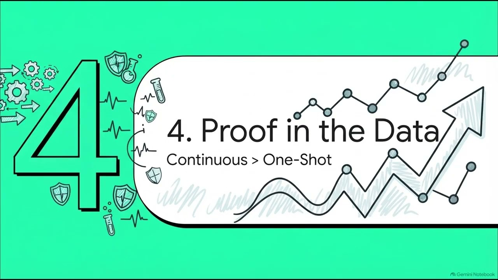

<div align="center">


### Continuous red-team replay, regression gating, incident runbooks, and chaos testing for clinical AI guardrails


[](https://huggingface.co/datasets/Quome/haarf-redteam)

[**Quickstart**](#quickstart) · [How it works](#how-it-works) · [Reproduce](#reproduce-the-experiments) · [Results](#headline-results) · [Paper](papers/015-redteam/main.pdf) · [Dataset](https://huggingface.co/datasets/Quome/haarf-redteam) · [Cite](#cite)

</div>

---

A guardrail evaluated once at submission and then deployed for months rots: attack classes evolve, configuration changes silently reopen closed vulnerabilities, live attacks need containment, and dependency failures must degrade safely. The redteam layer is an off-hot-path meta-layer of the qfire gateway that continuously exercises every other control: a loop-until-dry replay runner with deterministic mutation operators, a change-triggered regression gate, an incident-response runbook engine over the signed quledger decision stream, and a chaos/fault-injection harness that checks fail-safe invariants. On the HAARF-RedTeam corpus (62 attacks across all 8 HAARF control families and 13 gateway layers, tagged by MITRE ATLAS technique), continuous red-teaming discovers 62 distinct vulnerabilities versus 12 for a one-shot evaluation, the regression gate catches 100% of 75 reopened vulnerabilities, runbook automation cuts mean time-to-contain from 12 to 1 steps (91.7%), and the fail-safe gateway holds 12/12 resilience invariants. Coverage is reported honestly: 14 ATLAS techniques over 10 of 13 layers, with the layers unbuilt at corpus time (lifecycle, consent, device) named as untested.

<div align="center">

[](https://youtu.be/R0UM6z0Mswk)

**▶ Watch: [Qusiege: Continuous Red-Teaming and Resilience for Clinical AI Agents (talk)](https://youtu.be/R0UM6z0Mswk)**

</div>

`qusiege` is **a module of the QUOKKAGUARD program**: one Rust security gateway (`qfire`) that sits in front of any OpenAI-compatible model endpoint and decides **ALLOW ▸ forward · BLOCK ▸ refuse · ESCALATE ▸ human review** for every request and response. Each module adds exactly one enforcement layer to that gateway plus one adversarial dataset and one paper. This repository is a self-contained snapshot of the gateway with **this layer** (`src/redteam/`, on the *monitor* path, HAARF control C3.1/3.7/3.8), its dataset (**HAARF-RedTeam**), the experiment harness, and the paper.

> Everything here runs **offline**: no model API keys, no network calls in the experiments.

## How it works

- **Attack corpus keyed by vulnerability**: each AttackRecord carries a HAARF control family, MITRE ATLAS technique, target layer, built flag, payload, expected-block flag, and mutation lineage; a Vulnerability key of (control, atlas, layer) defines when two bypasses are the same, and an AttackProbe trait abstracts the gateway under test.
- **Modeled gateway defense**: each built layer carries block-signature substrings and an attack is blocked iff its (possibly mutated) payload still contains a signature for its target layer; unbuilt layers never block, so the coverage gap is surfaced rather than hidden. An optional live-Ollama slice re-probes a sample through the real engine.
- **Loop-until-dry discovery**: a one-shot run probes only the seed corpus (round 0); a continuous run applies deterministic mutation operators each round keyed by an FNV-1a hash of (round, attack id), with no RNG or clock. At or above an attack's evasion round (spread over rounds 1-6) dense separator insertion defeats any literal signature; the loop stops after 3 consecutive rounds add nothing new (MAX_ROUNDS 20), and monotone evasion makes the discovery curve non-decreasing and terminating.
- **Change-triggered regression gate**: a deployment change is modeled as a set of layers whose defenses are switched off; the gate re-probes the entire closed-vulnerability set under the change and blocks deployment if any closed vulnerability reopens (modeling the qupassport deployment gate).
- **Incident engine and chaos harness**: the incident engine consumes a decision stream, fires detection at the first step whose score crosses 0.5, then applies a fixed runbook (IsolateAgent, RevokeCapability, TripBreaker, Snapshot) with per-action latency of 1 step automated vs 12 steps manual; the chaos harness injects latency, dependency-loss, and partition faults and checks two invariants: no unsafe action (a fault never lets through a normally-blocked action) and bounded degradation (availability loss within a declared envelope).

## Quickstart

Requires Rust 1.85+ (`rustup`), Python 3.10+ for the analysis scripts, and `tectonic` (or `pdflatex`) only if you want to rebuild the paper.

```bash
git clone https://github.com/quome-cloud/qusiege
cd qusiege
cargo build --release
cargo test redteam   # this layer's tests
```

Then see the layer in action:

```bash
# 1. Generate the HAARF-RedTeam corpus (the JSONL files are gitignored; deterministic, seed 42)
python3 scripts/015-redteam/gen_redteam.py --seed 42
# writes datasets/015-redteam/{corpus,incidents,faults}.jsonl

# 2. Continuous vs one-shot discovery (E1): loop-until-dry replay against the modeled gateway, offline
cargo run --release --bin redteamrun -- e1 --data datasets/015-redteam --out results/015-redteam
# wrote results/015-redteam/e1_discovery.json   (one-shot 12 vulns, continuous 62, dry at round 9)

# 3. Regression gate (E2): 12 deployment changes that disable layers, every reopened vuln caught
cargo run --release --bin redteamrun -- e2 --data datasets/015-redteam --out results/015-redteam
# wrote results/015-redteam/e2_regression.json  (catch rate 100%, 75 reopenings)

# 4. Everything (E1-E5) then figures + numbers.tex
cargo run --release --bin redteamrun -- all --data datasets/015-redteam --out results/015-redteam
python3 scripts/015-redteam/summarize.py --results results/015-redteam --paper papers/015-redteam
```

## Reproduce the experiments

Every number in the paper traces to one of these runs (95% Wilson CIs, deterministic seeds, pinned model snapshots). Run outputs land in `results/015-redteam/` (not tracked; see [`results/015-redteam/README.md`](results/015-redteam/README.md) for the exact regeneration commands).

| Exp | What it measures | Needs |
|---|---|---|
| E1 | Continuous vs one-shot discovery: distinct vulnerabilities found per round until the loop goes dry | offline |
| E2 | Regression catch at the deployment gate: re-probe the closed set under 12 layer-disabling changes | offline |
| E3 | Incident response: detection recall, MTTD, and MTTC for manual vs automated runbooks over 60 incident streams | offline |
| E4 | Resilience under injected latency / dependency-loss / partition faults: production invariants held, planted validation breaks caught | offline |
| E5 | Cost vs coverage: cumulative probes vs distinct-vulnerability coverage, ATLAS technique and layer coverage with the built/unbuilt gap | offline |
| all | Regenerate corpus, run E1-E5, and rebuild figures + numbers.tex | offline |

```bash
# E1 — Continuous vs one-shot discovery: distinct vulnerabilities found per round until the loop goes dry
cargo run --release --bin redteamrun -- e1 --data datasets/015-redteam --out results/015-redteam

# E2 — Regression catch at the deployment gate: re-probe the closed set under 12 layer-disabling changes
cargo run --release --bin redteamrun -- e2 --data datasets/015-redteam --out results/015-redteam

# E3 — Incident response: detection recall, MTTD, and MTTC for manual vs automated runbooks over 60 incident streams
cargo run --release --bin redteamrun -- e3 --data datasets/015-redteam --out results/015-redteam

# E4 — Resilience under injected latency / dependency-loss / partition faults: production invariants held, planted validation breaks caught
cargo run --release --bin redteamrun -- e4 --data datasets/015-redteam --out results/015-redteam

# E5 — Cost vs coverage: cumulative probes vs distinct-vulnerability coverage, ATLAS technique and layer coverage with the built/unbuilt gap
cargo run --release --bin redteamrun -- e5 --data datasets/015-redteam --out results/015-redteam

# all — Regenerate corpus, run E1-E5, and rebuild figures + numbers.tex
python3 scripts/015-redteam/gen_redteam.py --seed 42 && cargo run --release --bin redteamrun -- all --data datasets/015-redteam --out results/015-redteam && python3 scripts/015-redteam/summarize.py --results results/015-redteam --paper papers/015-redteam
```

**Dataset — HAARF-RedTeam** (`datasets/015-redteam/`): A self-contained synthetic corpus (JSONL files gitignored, regenerated from the tracked generator): corpus.jsonl with 62 AttackRecords (one canonical attack per vulnerability, 5 per built layer and 4 per unbuilt layer) spanning all 8 HAARF control families and 13 target layers tagged with 14 MITRE ATLAS techniques, expected-block flags, and built/unbuilt status; incidents.jsonl with 60 decision streams (half carrying an injected attack, half benign controls); and faults.jsonl with latency, dependency-loss, and partition scenarios in a production (fail-safe) and a validation (planted-broken) arm; seed 42, no PHI.

Regenerate the corpus (deterministic seeds):

```bash
python3 scripts/015-redteam/gen_redteam.py --seed 42
```

The corpus is also published as a Hugging Face dataset with a full data card: **[Quome/haarf-redteam](https://huggingface.co/datasets/Quome/haarf-redteam)** (`datasets.load_dataset("Quome/haarf-redteam")`, or `hf download Quome/haarf-redteam --repo-type dataset`).

All data are synthetic; no protected health information is used anywhere in this repository.

## Headline results

| Metric | Value | Context |
|---|---|---|
| Distinct vulnerabilities discovered (E1) | **62 continuous vs 12 one-shot (50 more)** | 62-attack corpus; curve plateaus by round 6 and goes dry at round 9 |
| Regression catch rate (E2) | **100.0%** | 75 reopened vulnerabilities across 12 deployment changes from a closed set of 50 |
| Mean time-to-contain (E3) | **12 -> 1 steps (91.7% reduction)** | 100.0% detection recall, mean time-to-detect 3.7 steps; latencies are modeling assumptions |
| Resilience invariants under injected faults (E4) | **12/12 held (production); 6/6 planted violations caught (validation)** | latency, dependency-loss, and partition faults at two magnitudes each |
| Coverage (E5) | **14 MITRE ATLAS techniques over 10 of 13 layers** | lifecycle, consent, device tagged unbuilt at corpus time and reported as not tested |

Full methodology, ablations, and statistics: **[the paper](papers/015-redteam/main.pdf)**.

## The paper

**Defenses That Pass Once and Rot: Continuous Red-Teaming, Incident Response, and Resilience as a Meta-Layer for Clinical AI Guardrails**

- PDF: [`papers/015-redteam/main.pdf`](papers/015-redteam/main.pdf)
- Source: [`papers/015-redteam/`](papers/015-redteam/) — `main.tex`, `numbers.tex` (every headline macro, generated by the scripts above), `figs/`, `refs.bib`
- Pre-registered proposal (threat model, hypotheses, experiment→figure map): [`papers/015-redteam/PROPOSAL.md`](papers/015-redteam/PROPOSAL.md)
- Rebuild: `cd papers/015-redteam && make paper` (tectonic, or pdflatex + bibtex)

## Repository layout

| Path | What |
|---|---|
| `src/` | The `qfire` gateway crate. This paper's layer lives in `src/redteam/`; the other modules are the always-on baseline it plugs into. |
| `src/bin/` | CLI (`qfire`) and per-paper experiment harnesses |
| `rules/`, `chains/` | Declarative rule and detector-chain library used by the gateway |
| `datasets/015-redteam/` | HAARF-RedTeam (also on Hugging Face: [Quome/haarf-redteam](https://huggingface.co/datasets/Quome/haarf-redteam)) |
| `scripts/015-redteam/` | Dataset generator, experiment runners, figure and `numbers.tex` builders |
| `scripts/common/` | Shared helpers |
| `papers/015-redteam/` | The paper (LaTeX + PDF + proposal) |
| `results/015-redteam/` | Experiment outputs (see above) |
| `tests/`, `benches/` | Integration tests and Criterion benches |
| `SNAPSHOT.md` | Which `quokkaguard` commit this repo was exported from |

## Relationship to QUOKKAGUARD

This repo is a **snapshot** of the QUOKKAGUARD program's gateway (export `1c04c3a34841`, 2026-10-02), filtered to the `qusiege` module. The full `qfire` crate is included so this layer builds, tests, and runs standalone; the other modules are the always-on baseline the layer plugs into. Issues and pull requests are welcome here.

This layer builds on: [QFIRE (medRxiv)](https://www.medrxiv.org/content/10.64898/2026.06.04.26354950v1), [quanchor](https://github.com/quome-cloud/quanchor), [quledger](https://github.com/quome-cloud/quledger), [qubom](https://github.com/quome-cloud/qubom), [quwarden](https://github.com/quome-cloud/quwarden), [qudam](https://github.com/quome-cloud/qudam), [quantidote](https://github.com/quome-cloud/quantidote), [quorum](https://github.com/quome-cloud/quorum), [qutriage](https://github.com/quome-cloud/qutriage), [qufair](https://github.com/quome-cloud/qufair), [qudrift](https://github.com/quome-cloud/qudrift), [qupassport](https://github.com/quome-cloud/qupassport), [quconsent](https://github.com/quome-cloud/quconsent), [qubroker](https://github.com/quome-cloud/qubroker).

Sibling repos in the series: [quanchor](https://github.com/quome-cloud/quanchor), [quledger](https://github.com/quome-cloud/quledger), [qubom](https://github.com/quome-cloud/qubom), [quwarden](https://github.com/quome-cloud/quwarden), [qudam](https://github.com/quome-cloud/qudam), [quantidote](https://github.com/quome-cloud/quantidote), [quorum](https://github.com/quome-cloud/quorum), [qutriage](https://github.com/quome-cloud/qutriage), [qufair](https://github.com/quome-cloud/qufair), [qudrift](https://github.com/quome-cloud/qudrift), [qupassport](https://github.com/quome-cloud/qupassport), [quconsent](https://github.com/quome-cloud/quconsent), [qubroker](https://github.com/quome-cloud/qubroker).

## Cite

If you use this code or dataset, cite the paper and the HAARF framework it implements:

```bibtex
@unpublished{schwoebel2026qusiege,
  author = {Schwoebel, Jim and {QUOKKAGUARD Contributors}},
  title  = {Defenses That Pass Once and Rot: Continuous Red-Teaming, Incident Response, and Resilience as a Meta-Layer for Clinical AI Guardrails},
  note   = {Preprint. Quome, QUOKKAGUARD program (qusiege module)},
  year   = {2026},
  url    = {https://github.com/quome-cloud/qusiege}
}

@unpublished{schwoebel2026haarf,
  author = {Schwoebel, Jim and Frasch, Martin and Spalding, Art and Sewell, Ed and Englert, Phil and Halpert, Ben and Overbay, Collin and Semenec, Ingrida and Shor, Joel},
  title  = {{HAARF}: Healthcare {AI} agents regulatory framework --- a comprehensive security verification standard for autonomous {AI} systems in clinical environments},
  note   = {medRxiv Preprint},
  year   = {2026},
  month  = {April},
  doi    = {10.64898/2026.04.09.26350519},
  url    = {https://www.medrxiv.org/content/10.64898/2026.04.09.26350519v1}
}
```

## Status

Research prototype. It demonstrates the layer end to end with reproducible experiments; it is not a certified medical device or a production security product. Threat-model boundaries and known gaps are in the paper's Discussion.

## License

Apache License 2.0 — see [LICENSE](LICENSE). Copyright (c) 2026 Quome, Inc.
